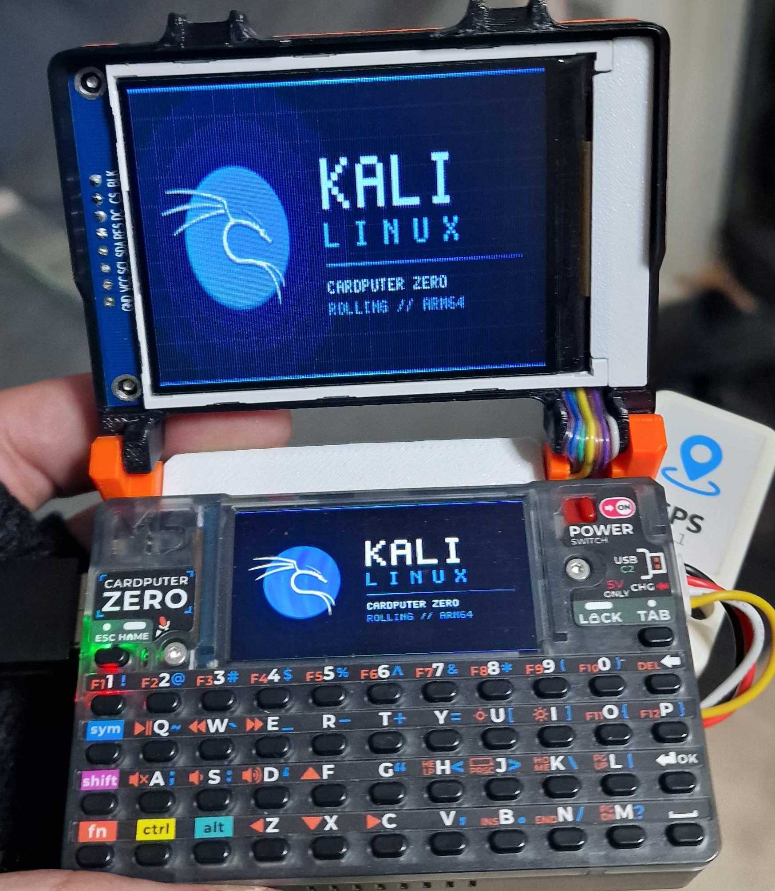
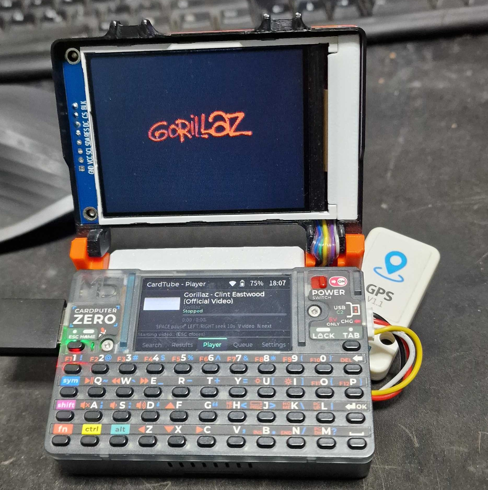

# Cardputer Zero — Screen CAP HAT (Dual-Display Suite)

Turn your **M5Stack Cardputer Zero** (CM0 / BCM2835 / Rev v5) + top 14-pin expansion header (`EXT 2.54-14P`) into a **dual-screen Linux pocket cyberdeck** using an inexpensive SPI TFT display (like the **TERM512 / CapTFT V2** clamshell mod) — **no HDMI required**, and your built-in 1.9" display stays 100% untouched.

| Live Screen Mirroring (`fb_mirror`) | Independent Dual-Screen Playback (`/dev/fb_cap`) |
| :---: | :---: |
|  |  |

> **Zero external Python dependencies.** Runs natively on Linux TinyDRM (`panel-mipi-dbi`), a low-CPU C framebuffer mirror (`fb_mirror`), and pure Python standard library tools.

---

## Highlights

- **Real Secondary Linux Display (`/dev/fb_cap` & `/dev/dri/cardputer-zero-cap`):**
  Custom Device Tree Overlay (`cardputer-cap-display.dtbo`) binds `SPI0 CE1` (`GPIO7`), `DC` (`GPIO22`), `RST` (`GPIO26`), and `gpio-backlight` (`GPIO23`), and automatically enables the software-switched Pin 6 `5V OUT` rail (`M5IOE1` `ext_5v_out`) at boot.
- **Built-In Screen & Shared Buses Protected:**
  Never touches `SPI0 CE0` (`GPIO8`), `/dev/fb_lcd`, `/dev/dri/cardputer-zero-internal`, or shared `I2C1` devices (audio codec, RTC, keyboard, battery gauge, IMU, `M5IOE1`). Stable udev rules track both displays even when framebuffer numbers shift across boots.
- **Smooth Live Screen Mirror (`fb_mirror`):**
  Native C daemon (`gcc -O2`) mirrors the built-in `320×170` screen onto the `320×240` top screen (`smooth` vertical interpolation, `nearest`, or `center` 1:1) with **zero SPI traffic while idle**.
- **Independent Multi-Page Cyberdeck HUD (`cap_hud.py`):**
  Keep the Cardputer Zero launcher running on the bottom screen while showing live widgets on top:
  - **`status`** — CPU %, clock, temperature, 60-sample CPU sparkline, RAM & Disk bars, load, battery %, voltage, IP, Wi-Fi RSSI.
  - **`net`** — Live RX/TX KB/s throughput + rolling sparkline, Wi-Fi SSID/dBm, all active IPv4 interfaces.
  - **`proc`** — Live mini-`top` (top 10 processes by CPU% and RAM%).
  - **`clock`** — Giant digital standby clock with date, battery, temp, and IP.
  - **`log` / `run` / `watch`** — Stream `journalctl` or any live command output onto the top screen without switching virtual terminals.
- **Built-In Keyboard Hotkeys & Interactive On-Screen Menu (`cap_hotkeys.py`):**
  Press **`Ctrl + Alt + Space`** on the Cardputer Zero keyboard to open an on-screen Mode Menu right on the top screen, or jump directly to any mode with `Ctrl + Alt + <key>` — plus the `cap-screen` CLI for SSH and scripts.
- **Instant `<50ms` Switching & Clean Shutdown (`cap_supervisor.py`):**
  Local UNIX-socket supervisor (`/run/cap-display/ctl.sock`) switches modes instantaneously without restarting systemd, and clears the screen + turns off the backlight cleanly on shutdown.

---

## Hardware Needed (BOM)

- **M5Stack Cardputer Zero** (Hardware Rev v5, tested on Kali Linux / Raspberry Pi OS 64-bit kernel `6.18.x`)
- **8-pin SPI TFT Display** (`320×240` **ILI9341** 2.4"/2.8" or **ST7789** 2.0"/2.4", pins: `GND VCC SCL SDA RES DC CS BLK`)
- **2×7 (14-pin) 2.54mm header** + 8-wire ribbon cable
- **3.3V Voltage Regulator** *(only needed if your TFT module does NOT have an onboard 3.3V regulator and expects 3.3V on `VCC`)*
- *(Optional)* 3D-printed clamshell hinge/enclosure (e.g., **TERM512 / CapTFT V2**)

---

## Wiring Guide (`EXT 2.54-14P`)

> **Important:** All CM0 GPIOs and SPI lines are **3.3V logic only**. Pin 6 (`5V OUT`) is software-switched via `M5IOE1` (`0x4F`) and disabled by default on stock OS until our overlay/service enables it.

### Header Pin Layout (Top View)

```text
          EXT 2.54-14P (Cardputer Zero)
           Odd Pins         Even Pins
    RES -> [ 1: GPIO26 ]   [ 2: 5V IN  ]
    BLK -> [ 3: GPIO23 ]   [ 4: GND    ] <- GND
     DC -> [ 5: GPIO22 ]   [ 6: 5V OUT ] <- VCC (or 3.3V reg VIN)
    SCL -> [ 7: GPIO11 ]   [ 8: GPIO2  ] (I2C1 SDA - shared)
    SDA -> [ 9: GPIO10 ]   [10: GPIO3  ] (I2C1 SCL - shared)
           [11: GPIO9  ]   [12: GPIO15 ] (UART RXD)
     CS -> [13: GPIO7  ]   [14: GPIO14 ] (UART TXD)
```

### Pin-by-Pin Table

| EXT 14P Pin | Cardputer Zero Signal | Display Pin | Notes |
| :---: | :--- | :--- | :--- |
| **Pin 1** | `GPIO26` | `RES` / `RST` | Hardware reset (`ext_usb_gpio_fun=0` keeps GPIO mode) |
| **Pin 3** | `GPIO23` | `BLK` / `BL` | Backlight (`gpio-backlight` -> `/sys/class/backlight/cap-backlight`) |
| **Pin 4** | `GND` | `GND` | Common ground |
| **Pin 5** | `GPIO22` | `DC` | Data / Command |
| **Pin 6** | `5V OUT` (`M5IOE1` IO13) | `VCC` | Auto-enabled at boot (use 3.3V reg if panel has none onboard) |
| **Pin 7** | `GPIO11` (`SPI0_SCLK`) | `SCL` / `SCK` | Shared `SPI0` clock |
| **Pin 9** | `GPIO10` (`SPI0_MOSI`) | `SDA` / `MOSI` | Shared `SPI0` data |
| **Pin 13** | `GPIO7` (`SPI0_CE1`) | `CS` | Secondary chip select (`CE0`/`GPIO8` is reserved for internal LCD) |

> **Coming from Cardputer-Adv CapTFT V2 / TERM512?**
> The original CapTFT V2 wiring diagram was made for the ESP32-S3 Cardputer-Adv, which remaps SPI pins in software. On the Cardputer Zero (BCM2835), `SPI0` is hardware-fixed to Pins 7 (`GPIO11`), 9 (`GPIO10`), and 11 (`GPIO9`), so make sure your ribbon cable follows the Cardputer Zero table above.

---

## Installation

### 1. Clone on the Cardputer Zero
```bash
git clone https://github.com/jayis1/cardputerZero-Screen-Cap-Hat-.git ~/cap-display
cd ~/cap-display
```

### 2. (Optional) Live Zero-Reboot Wiring Test
While `/dev/spidev0.1` is still active (before installing the kernel overlay), you can verify your wiring, backlight blink, controller type, and colors immediately:
```bash
# Test ILI9341 (e.g., TERM512 / CapTFT V2 2.4" / 2.8"):
sudo python3 probe_spi_display.py --preset ili9341-320x240 --blink-bl

# Or test ST7789 IPS (e.g., GMT020-02 2.0"):
sudo python3 probe_spi_display.py --preset st7789-320x240 --blink-bl
```

### 3. Install Driver Overlay, Mirror Daemon, HUD & Hotkeys
`install.sh` automatically creates a timestamped backup of `/boot/firmware/config.txt`, builds `/lib/firmware/cardputer-cap-lcd.bin`, compiles `cardputer-cap-display.dtbo` and `fb_mirror`, installs udev rules and CLI tools, and enables both systemd services.

```bash
# Verified preset for TERM512 / CapTFT V2 (ILI9341 320x240, upright MADCTL=0x28):
sudo ./install.sh --preset term512-ili9341 --mode mirror --scale smooth
sudo reboot
```

**Available Display Presets:**
| Preset | Panel | Resolution | Notes |
| :--- | :--- | :--- | :--- |
| `term512-ili9341` | ILI9341 (TERM512 / CapTFT V2) | `320×240` | Verified upright `MADCTL=0x28`, BGR, `INVOFF` |
| `ili9341-320x240` | Generic ILI9341 | `320×240` | Landscape, BGR, `INVOFF` |
| `st7789-320x240` | ST7789V IPS (GMT020-02 style) | `320×240` | Landscape, RGB, `INVON` |
| `st7789-320x240-noinv` | ST7789V (non-inverted) | `320×240` | Landscape, RGB, `INVOFF` |
| `st7789-240x240` | ST7789V Square 1.3"/1.54" | `240×240` | Square, RGB, `INVON` |
| `st7735-160x128` | ST7735S 1.8" | `160×128` | Landscape, RGB, `INVOFF` |

Extra `install.sh` flags: `--rotation 0|90|180|270`, `--madctl 0xXX`, `--bgr` / `--rgb`, `--invert` / `--no-invert`, `--x-offset`, `--y-offset`, `--speed HZ`, `--spi-mode 0|3`, `--mode mirror|status|net|proc|clock|ready|off`, `--scale smooth|nearest|center`, `--fps 20`.

### 4. Verify After Reboot
```bash
/usr/local/bin/check_ext_display.sh
cap-screen info
```

---

## Controls & Usage

### Built-In Keyboard Hotkeys
All shortcuts use **`Ctrl + Alt + <key>`** so normal typing is never affected:

| Shortcut | Action |
| :--- | :--- |
| **`Ctrl + Alt + Space`** | Open **Interactive On-Screen Mode Menu** (`1–9` / `W,S` / `J,K` / Arrows + `Enter`; `Esc`/`Q` cancels) |
| **`Ctrl + Alt + N`** | Cycle modes (`Mirror` -> `Sys HUD` -> `Net/Wi-Fi` -> `Procs` -> `Clock` -> `Sleep`) |
| **`Ctrl + Alt + B`** | Toggle top screen **Sleep / Wake** (backlight off + pause renderer) |
| **`Ctrl + Alt + M`** | **Mirror** mode (press again to toggle `Smooth Fill` <-> `1:1 Center`) |
| **`Ctrl + Alt + S`** | **System Telemetry + CPU Sparkline HUD** |
| **`Ctrl + Alt + W`** | **Network / Wi-Fi / Live RX-TX Throughput HUD** |
| **`Ctrl + Alt + P`** | **Top Processes HUD** |
| **`Ctrl + Alt + C`** | **Big Cyberdeck Clock Standby HUD** |
| **`Ctrl + Alt + L`** | **Live Scrolling `journalctl` Log Feed** |
| **`Ctrl + Alt + T`** | Toggle **Interactive Linux Terminal (`tty3`)** on the top screen |

### `cap-screen` CLI
```bash
cap-screen menu                       # Open interactive mode picker on top screen
cap-screen mirror                     # Smooth full-screen mirror of built-in LCD
cap-screen mirror center              # 1:1 pixel-perfect centered mirror
cap-screen mirror nearest 30          # Fast nearest-neighbor mirror @ 30 FPS max
cap-screen status                     # System telemetry + 60-sample CPU sparkline
cap-screen net                        # Network / Wi-Fi / RX-TX throughput HUD
cap-screen proc                       # Live top processes HUD
cap-screen clock                      # Giant standby clock + battery + IP
cap-screen log                        # Live scrolling system journal
cap-screen log ssh                    # Live log stream for a specific systemd unit
cap-screen run "ping -i 1 1.1.1.1"    # Stream any live command onto top screen
cap-screen watch 2 "ss -tulnp"        # Refresh command output every 2s on top screen
cap-screen tty                        # Interactive Linux console (tty3) on top screen
cap-screen ready                      # Clear & release /dev/fb_cap for external apps
cap-screen off | on | toggle          # Sleep / wake top screen
cap-screen next | prev                # Cycle modes
cap-screen info                       # Show current mode, scale, FPS, backlight state
```

Append **`--save`** to persist a mode as your boot default in `/etc/default/cardputer-cap-display`:
```bash
cap-screen status --save
```

### Sending External Apps to the Top Screen
Run `cap-screen ready` first, then target `/dev/fb_cap` or `/dev/dri/cardputer-zero-cap`:

```bash
# Display an image
sudo fbi -d /dev/fb_cap -T 1 -a image.png

# Run a pygame / SDL app on the top screen
SDL_FBDEV=/dev/fb_cap python3 your_app.py

# Play video directly via DRM
mpv --vo=drm --drm-device=/dev/dri/cardputer-zero-cap video.mp4

# Manual backlight toggle
echo 0 | sudo tee /sys/class/backlight/cap-backlight/brightness
echo 1 | sudo tee /sys/class/backlight/cap-backlight/brightness
```

---

## Live Orientation / Color Tuning (No Reboot)

If your display panel is rotated, mirrored, or color-inverted, you can update `/lib/firmware/cardputer-cap-lcd.bin` and live-reload `spi0.1` in 1 second without rebooting:

```bash
sudo systemctl stop cardputer-cap-display
sudo python3 ~/cap-display/gen_panel_fw.py --preset ili9341-320x240 --madctl 0x28 -o /lib/firmware/cardputer-cap-lcd.bin
sudo /usr/local/bin/check_ext_display.sh --reinit
sudo systemctl start cardputer-cap-display
```

| Issue | Fix Flag |
| :--- | :--- |
| Inverted colors (white bg / black text) | Add `--invert` (or `--no-invert`) |
| Red and Blue swapped | Add `--rgb` (or `--bgr`) |
| Rotated or mirrored | Try `--madctl 0x28`, `0x68`, `0xA8`, or `0xE8` (for RGB panels: `0x20`, `0x60`, `0xA0`, `0xE0`) |

---

## Repository Layout

| File | Description |
| :--- | :--- |
| `cardputer-cap-display.dts` | Device Tree Overlay for `spi0.1` (`panel-mipi-dbi`), `GPIO23` backlight, and `ext_5v_out` default-on |
| `gen_panel_fw.py` | Generates & verifies Linux `panel-mipi-dbi` v1 init firmware (`/lib/firmware/cardputer-cap-lcd.bin`) |
| `99-cardputer-cap-lcd.rules` | Udev rules creating stable `/dev/fb_cap` and `/dev/dri/cardputer-zero-cap` symlinks |
| `check_ext_display.sh` | Verifies GPIO mux, enables Pin 6 5V rail, inspects `/dev/fb_cap` & `/dev/i2c-1`, supports `--reinit` |
| `fb_mirror.c` | Low-CPU C framebuffer mirror daemon (`/dev/fb_lcd` -> `/dev/fb_cap`) |
| `cap_hud.py` | Pure-Python multi-page Cyberdeck HUD (`status`, `net`, `proc`, `clock`, `log`, `run`, `watch`, `menu`) |
| `cap_supervisor.py` | Fast UNIX-socket mode supervisor (`/run/cap-display/ctl.sock`) |
| `cap-screen` | Command-line switcher (`/usr/local/bin/cap-screen`) |
| `cap_hotkeys.py` | Passive evdev hotkey daemon & interactive on-screen menu |
| `fb_cap_tool.py` | Standalone lightweight `/dev/fb_cap` helper (`clear`, `test`, `status`) |
| `probe_spi_display.py` | Pre-install zero-reboot `/dev/spidev0.1` hardware probe |
| `cardputer-cap-display.service` | Systemd unit for `cap_supervisor.py` |
| `cardputer-cap-hotkeys.service` | Systemd unit for `cap_hotkeys.py` |
| `install.sh` / `uninstall.sh` | Safe installer (backs up `config.txt`) and full rollback script |

---

## Troubleshooting

- **Screen stays white after boot:**
  Run `/usr/local/bin/check_ext_display.sh` and check `dmesg | grep -iE 'mipi|spi0\.1'`. Ensure `ext_5v_out=255` and `ext_usb_gpio_fun=0`, then try `sudo /usr/local/bin/check_ext_display.sh --reinit && sudo systemctl restart cardputer-cap-display`.
- **Root filesystem read-only during install:**
  If `/boot/firmware` failed to mount on a boot, reboot cleanly so `fsck.repair=yes` runs, then confirm both `/` and `/boot/firmware` are mounted `rw` (`mount | grep -E ' on /(boot/firmware)? '`).
- **Hotkeys not responding:**
  Check `systemctl status cardputer-cap-hotkeys` and verify `/dev/input/cardputer-zero-internal` exists.

---

## Uninstall / Rollback

Safely removes the overlay, firmware, udev rules, binaries, and systemd services, and cleans `/boot/firmware/config.txt` (creating a backup first):

```bash
cd ~/cap-display
sudo ./uninstall.sh
sudo reboot
```

---

## Credits

- Built for the **M5Stack Cardputer Zero** (Rev v5) Linux ecosystem
- Uses the Linux kernel's generic **`panel-mipi-dbi`** TinyDRM driver
- Inspired by the **TERM512 / CapTFT V2** dual-screen clamshell community mods
